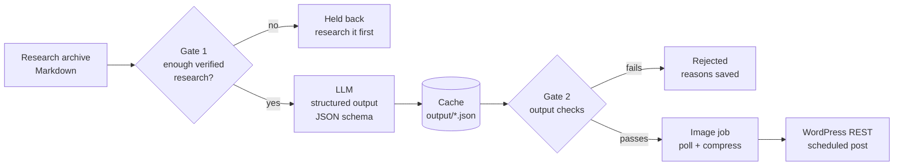

# research-to-article-pipeline

Turns research notes that a person has already checked into complete, scheduled WordPress articles, using an LLM with structured output. Two quality gates keep the model from publishing what it cannot back up.

I run this for my own tech site. This repository is a cleaned-up version: same design, English prompts, example data instead of my real research archive, and no credentials.

## The decision behind it

The site needed original articles at volume. The obvious build already existed in Make.com: a robot that took tech news from an RSS feed, had an LLM rewrite it, and posted it three times a day.

**I switched it off before it went live.** Google's 2026 guidance on *scaled content abuse* targets exactly that pattern: rewritten content that adds nothing to its source. Sites hit by it were reporting traffic drops of 50–80%, and AdSense rejects the same thing as "low value content".

The asset I already had was different: the research behind my social posts. Every carousel started as notes I had checked myself, with free-plan limits, platform restrictions and tools I had discarded and why. Automating *research, writing and publishing* is what search engines punish. Automating *formatting and publishing research a person already did* is not. So that is what this pipeline does.

## How it works



**Gate 1, before the model.** An entry only goes in with 500+ characters of research *and* verification markers (`VERIFIED`, `CAVEAT`, `DISCARDED`…). In testing, a thin entry produced an article that listed a paid tool inside a "free tools" piece: with nothing to read, the model fills the gaps with what it thinks it knows. On my archive, 32 entries passed and 16 were held back for new research.

**Structured output.** The model answers against a JSON schema (title, SEO title, description, category from a fixed list, image prompt, alt text, HTML body). The answer is valid JSON or an error, never "almost JSON" that breaks three steps later.

**Gate 2, after the model.** A schema guarantees the shape, not the content. `validate.js` rejects an article if a length limit is broken, the table of contents points to a heading that does not exist, the HTML contains Markdown or an `<h1>`, or the text uses a phrase the site cannot honestly say ("we tested", "our team": the site is run by one person).

**Safe to re-run.** Dry run is the default way to start. Generated articles are cached, so a reviewed dry run publishes exactly the text that was read, without paying for the API twice. A state file stops anything from being published twice. New posts are scheduled after the last one already queued, never on top of it.

**Images.** The image API is a create-then-poll job. It returns a ~2 MB PNG; the featured image appears on every card of the home page, so it is resized to 1200px and re-encoded as JPEG (about 150–250 KB) before upload, with alt text.

## Run it

Requires Node.js 22+.

```bash
npm test               # 10 tests, no network
npm run list           # what passes gate 1, what is held back
npm run mock           # full run with no API key and nothing published
```

With real services, copy `.env.example` to `.env` and fill it in:

```bash
node src/cli.js --dry-run --limit 1   # real model, nothing published: read output/ first
node src/cli.js --draft --limit 3     # publish as drafts
node src/cli.js --limit 3             # publish, scheduled on PUBLISH_DAYS at PUBLISH_TIME
```

Other flags: `--only "text"`, `--no-image`, `--archive <file>`, `--categories <file>`, `--out <dir>`.

## Results on my site

- Of 48 research entries, 32 passed gate 1 and 16 were held back rather than guessed.
- About US$0.15 of model cost per article (1,300–1,800 words).
- Published on a fixed schedule, two mornings a week.

## Files

| File | What it does |
|---|---|
| `src/research.js` | Parses the archive and applies gate 1 |
| `src/prompts.js` | System prompt, article instructions, JSON schema |
| `src/llm.js` | Anthropic Messages API call, plus a mock for keyless runs |
| `src/validate.js` | Gate 2: output checks |
| `src/schedule.js` | Next publishing slots after the last scheduled post |
| `src/images.js` | Image job polling and compression |
| `src/wordpress.js` | REST client: titles, last scheduled post, media upload, post creation |
| `src/cli.js` | Orchestration and flags |

## How it was built

I designed the flow and made the calls: what to automate, what not to, where the gates go. I wrote the code by directing AI coding agents (Claude Code), then reviewed it and tested it against my live site.

---

Shared as a portfolio sample. All rights reserved.
